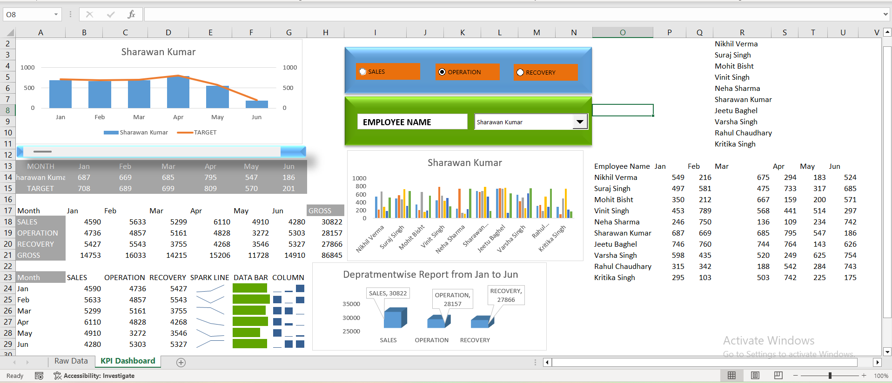

# 📊 EMPLOYEE-PERFORMANCE-KPI-DASHBOARD-X-EXCEL-Projects

An interactive Employee Performance & KPI Dashboard developed using Microsoft Excel to analyze employee performance, monitor monthly targets, compare departmental performance, and track key business metrics through dynamic charts, interactive controls, and data visualizations.

This project demonstrates how Microsoft Excel can be used as a Business Intelligence (BI) tool to transform raw employee performance data into meaningful insights, helping organizations monitor employee productivity, evaluate departmental performance, and support data-driven decision-making.

---

## 🚀 Project Overview

The objective of this project is to help organizations monitor and analyze employee performance across different departments.

The dashboard focuses on tracking monthly employee performance, comparing actual results against targets, evaluating department-wise performance, and monitoring overall business performance.

It provides insights into:

- Employee-wise Monthly Performance
- Monthly Target vs. Actual Performance
- Sales Department Performance
- Operation Department Performance
- Recovery Department Performance
- Department-wise Gross Performance
- Employee Performance Comparison
- Monthly Performance Trends
- Overall Departmental Performance

---

## 📈 Dashboard Features

✅ Interactive Employee Performance Dashboard

✅ Employee Selection Using Drop-Down Lists

✅ Department Selection Using Interactive Options

✅ Monthly Employee Performance Tracking

✅ Actual Performance vs. Target Comparison

✅ Sales, Operation & Recovery Analysis

✅ Department-wise Gross Performance Calculation

✅ Employee-wise Performance Comparison

✅ Dynamic Column Charts and Combo Charts

✅ Data Bars for Performance Comparison

✅ Sparklines for Monthly Performance Trends

✅ Dynamic KPI Reports and Data Visualization

---

## 🛠 Tools & Technologies Used

- Microsoft Excel
- Excel Formulas & Functions
- VLOOKUP
- MATCH
- OFFSET
- CHOOSE
- SUM
- RANDBETWEEN
- Data Validation
- Drop-Down Lists
- Interactive Controls
- Combo Charts
- Column Charts
- Sparklines
- Conditional Formatting
- Data Bars
- KPI Dashboard Development
- Data Visualization

---

## 📸 Dashboard Preview

**Employee Performance & KPI Dashboard:**

---

## 📌 Learning Outcomes

This project helped me improve my practical understanding of:

- Building interactive dashboards using Microsoft Excel.
- Tracking employee performance through monthly reports.
- Comparing actual performance against assigned targets.
- Analyzing department-wise business performance.
- Using Excel formulas to create dynamic reports.
- Implementing interactive employee and department selection.
- Creating meaningful visualizations using charts and sparklines.
- Transforming raw performance data into meaningful business insights.
- Designing professional and user-friendly Excel dashboards.

---

## 🤝 Connect With Me

**Karan Veer Pal**

📧 Email: karanpalveer@gmail.com

💼 LinkedIn: https://www.linkedin.com/in/karan-veer-pal/

💻 GitHub: https://github.com/Karan-Veer-Pal

If you find this project useful, feel free to ⭐ star this repository and share your feedback.

Thank you for visiting! 🚀
